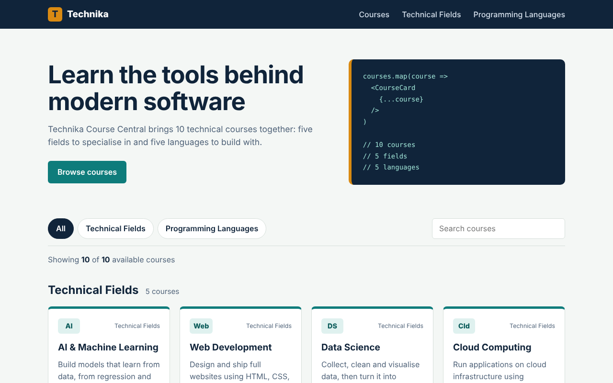
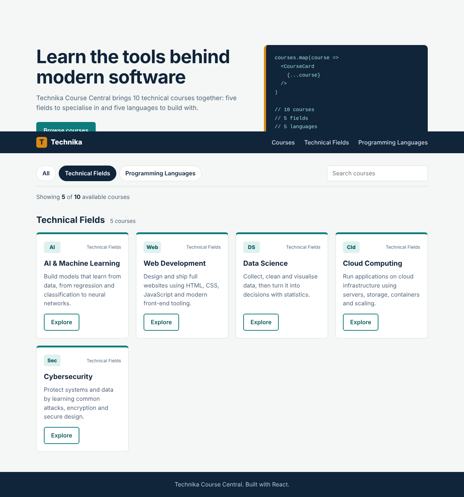
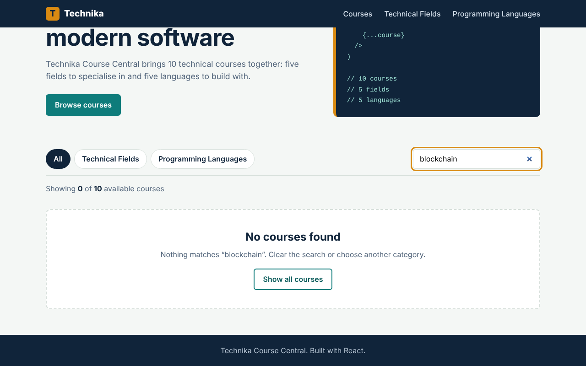

# Technika Course Central

A responsive course catalogue for exploring key areas of technology and the programming languages used to build modern software. The interface is built with React and Vite, with reusable components, category filters, live search, and expandable course topics.

## Features

- Browse 10 courses across technical fields and programming languages.
- Filter the catalogue by category and search course names or descriptions.
- Expand course cards to see their core topics.
- View responsive layouts, including a mobile navigation menu.
- See a helpful empty state when no courses match the current filters.
- Build a single-file production page with the Vite single-file plugin.

## Preview

| Course catalogue | Category filter |
| --- | --- |
|  |  |

| Mobile layout | Empty search state |
| --- | --- |
|  |  |

## Tech Stack

- React 18
- Vite 5
- JavaScript (ES modules)
- CSS

## Getting Started

### Prerequisites

- Node.js 18 or later
- npm

### Install and run

```bash
git clone https://github.com/Vicky-hue-ui/tecnika_course.git
cd tecnika_course
npm install
npm run dev
```

Open the local URL printed by Vite to view the app.

## Available Scripts

| Command | Description |
| --- | --- |
| `npm run dev` | Start the local development server. |
| `npm run build` | Create the production build in `dist/`. |
| `npm run preview` | Preview the production build locally. |

## Project Structure

```text
src/
├── components/
│   ├── CourseCard.jsx
│   ├── CourseList.jsx
│   ├── FilterBar.jsx
│   └── Navbar.jsx
├── data/
│   └── courses.js
├── App.jsx
├── index.css
└── main.jsx
screenshots/
index.html
vite.config.js
```

Course information is maintained in `src/data/courses.js` and passed to reusable UI components through props.

## Production Build

Run the production build with:

```bash
npm run build
```

The generated site is written to `dist/`. The Vite single-file plugin bundles the app's JavaScript and CSS into the HTML output for straightforward static hosting.

## License

No license has been specified for this project.
